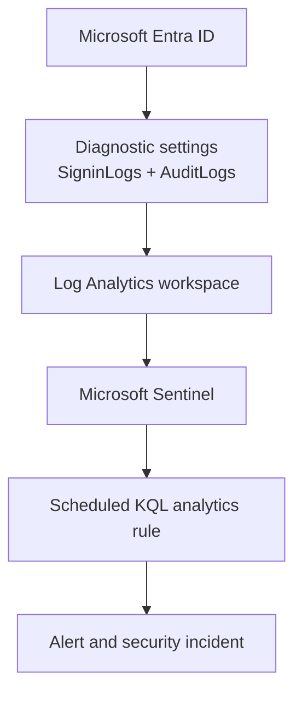

# Microsoft Sentinel — Entra ID Failed Sign-In Detection

> **SOC / Blue Team portfolio project:** built and validated an end-to-end Microsoft Sentinel detection for repeated failed Entra ID sign-ins.

| Recruiter snapshot | Details |
|---|---|
| Role focus | SOC Analyst · Blue Team · Detection Engineering |
| Core tools | Microsoft Sentinel · Microsoft Entra ID · Azure · Log Analytics · KQL |
| Outcome | Validated telemetry-to-incident pipeline using controlled failed-sign-in activity |
| Evidence | Detection query, alert configuration, incident screenshot, and repeatable triage workflow |

## What this project proves

- Configuring Entra ID diagnostic settings and validating log ingestion in Log Analytics
- Writing and deploying a scheduled KQL analytics rule in Microsoft Sentinel
- Mapping account and IP entities for faster investigation
- Generating and reviewing a security incident from controlled test activity
- Applying detection-engineering thinking: scope, threshold, severity, tuning, and documentation

## Detection use case

**Objective:** identify repeated failed Entra ID sign-ins from the same user and IP address that may indicate password spraying, brute-force, or credential-stuffing behavior.

**Data source:** `SigninLogs` forwarded from Microsoft Entra ID to a dedicated Log Analytics workspace.

**Detection:** [`detections/entra-id-failed-signins.kql`](detections/entra-id-failed-signins.kql)

| Configuration | Value |
|---|---|
| Rule name | Multiple Failed Entra ID Sign-ins |
| Rule type | Scheduled query |
| Lookback (rule scheduling) | 5 minutes |
| Query frequency | Every 5 minutes |
| Threshold | 3 failed attempts |
| Severity | Medium |
| Entity mapping | Account: `UserPrincipalName`; IP: `IPAddress` |
| Incident creation | Enabled |
| Alert grouping | Disabled (lab) |
| ATT&CK context | Credential Access — T1110.001 Brute Force: Password Guessing |

> This is a lab threshold, not a production baseline. A production deployment should tune exclusions, alert grouping, suppression, and thresholds against normal user behavior.

## Architecture



## Implementation and validation

### 1. Azure and Sentinel setup

- Verified the intended Azure tenant and subscription.
- Applied Contributor permissions at the subscription scope for resource deployment.
- Created a dedicated Log Analytics workspace (`law-sentinel-lab`) and enabled Microsoft Sentinel.


### 2. Entra ID log ingestion

- Deployed the Entra ID Sentinel solution.
- Sent `SigninLogs` and `AuditLogs` to the workspace through diagnostic settings.
- Confirmed successful `SigninLogs` ingestion with KQL.

```kql
SigninLogs
| take 5
```


### 3. Detection engineering

The rule aggregates failed sign-ins by user, source IP, and 10-minute window. It then alerts once the threshold is met.

```kql
SigninLogs
| where TimeGenerated > ago(30m)
| where ResultType != 0
| summarize FailedAttempts = count() by UserPrincipalName, IPAddress, bin(TimeGenerated, 10m)
| where FailedAttempts >= 3
```

| Line | What it does |
|---|---|
| `where ResultType != 0` | Keeps only failed sign-ins (`0` = success in `SigninLogs`) |
| `summarize ... by UserPrincipalName, IPAddress, bin(...)` | Counts failures per user, per source IP, per 10-minute bucket |
| `where FailedAttempts >= 3` | Alert threshold, kept low so the lab test triggers reliably |

> The rule's scheduling lookback is 5 minutes, so each run only evaluates the last 5 minutes of data even though the query contains `ago(30m)`. The scheduling setting is what bounds the query window.

**Window trade-off:** because each run only sees 5 minutes of data, the 10-minute `bin()` never fills completely within one run. Failures that land on either side of a run boundary (for example, 2 in one run and 2 in the next) can be split and miss the threshold. For the controlled test this was acceptable. A production version should lengthen the lookback to match the bin (for example, 10-minute lookback every 5 minutes) and use alert suppression to avoid duplicate incidents from the overlap.


### 4. Controlled test and incident validation

A non-privileged test account generated repeated failed sign-ins. Sentinel created an incident, validating the full path from telemetry to investigation.


## Analyst workflow

- Read the [detection brief](docs/detection-brief.md) for the use case, validation plan, ATT&CK context, and tuning notes.
- Follow the [analyst triage checklist](docs/analyst-triage-checklist.md) to scope, investigate, and document an alert.
- See the [incident walkthrough](docs/incident-walkthrough.md) for the controlled validation process.

## Skills demonstrated

Microsoft Sentinel · Microsoft Entra ID · Azure RBAC · Log Analytics · KQL · SIEM deployment · identity telemetry · alert triage · detection engineering · incident validation

## Lessons learned

- Sentinel scheduled analytics rules are not real-time detections.
- Explicit time filtering matters for KQL performance and predictable results.
- The rule's scheduling lookback overrides a longer `ago()` filter in the query, so documentation should state the scheduled value.
- RBAC and managed-identity permissions can block otherwise correct deployments.
- Controlled testing with non-administrative accounts reduces the risk of accidental lockouts.
- A working rule still needs tuning before it is useful in production.

## Next improvements

- Add alert grouping and suppression to reduce repeated incident creation from overlapping lookback windows.
- Align the lookback with the 10-minute aggregation window so failures that span two runs are not split.
- Add a password-spraying variant (T1110.003) that groups by source IP across many users instead of per user.
- Record test metrics (failed attempts generated, time to alert, false positives over a baseline period).
- Add detections for risky sign-ins and anomalous locations.
- Build a Sentinel workbook for authentication trends and investigation context.
- Integrate Microsoft Defender telemetry and document cross-source triage.

## Disclaimer

Completed in a controlled lab environment for educational and portfolio purposes. Detection thresholds and response procedures must be adjusted before production use.
